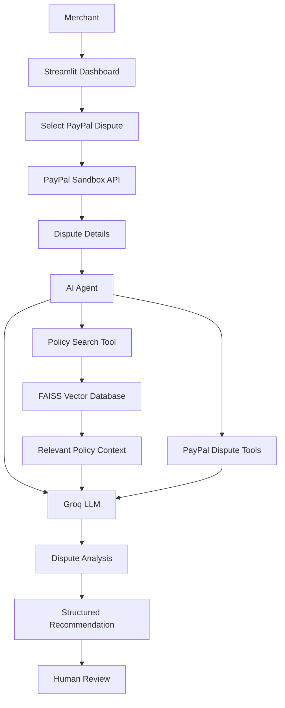
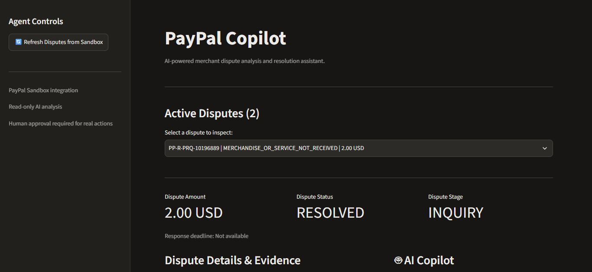
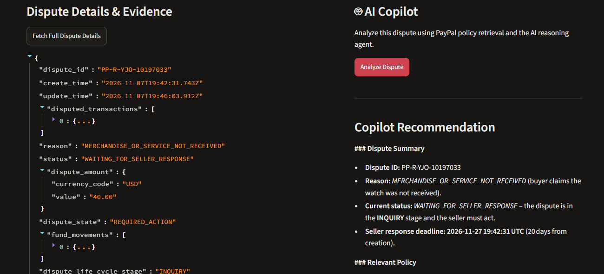
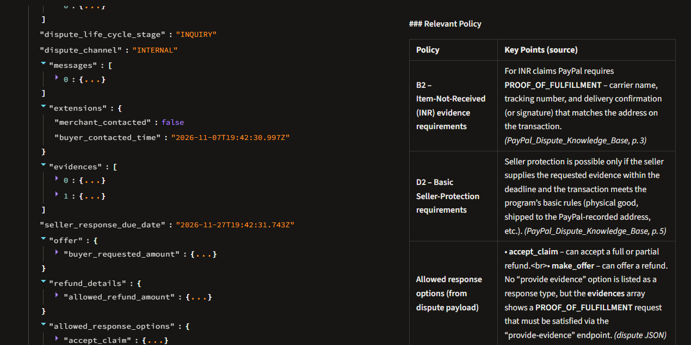
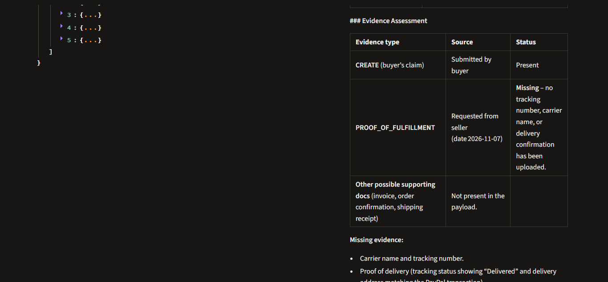
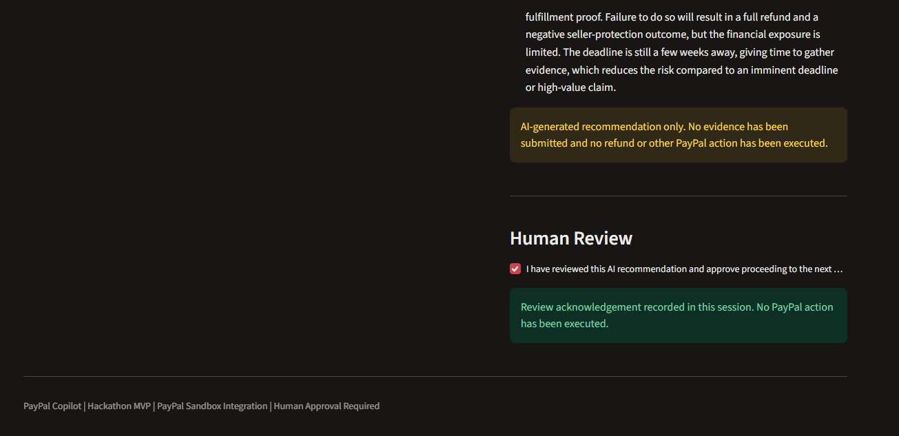

# PayPal Copilot

### AI-Powered Merchant Dispute Analysis & Resolution Assistant

[PayPal Copilot Cover](assets/paypal_copilot_cover.png)

[](https://paypal-copilot-agenta.streamlit.app/)
[](https://www.python.org/)
[](https://groq.com/)
[](https://github.com/facebookresearch/faiss)
[](LICENSE)

**PayPal Copilot** is an AI-powered merchant dispute analysis assistant designed to help merchants understand PayPal disputes, retrieve relevant policy guidance, evaluate available evidence, and receive structured recommendations for handling disputes.

Instead of manually reviewing dispute details and searching through policy documentation, merchants can use an AI agent that combines PayPal Sandbox APIs, Retrieval-Augmented Generation (RAG), and LLM-based reasoning.

<sub>Live application: https://paypal-copilot-agenta.streamlit.app/</sub>

---

## Overview

Managing payment disputes can be time-consuming. Merchants need to understand the reason for a dispute, review transaction information, identify relevant policies, and determine what evidence may be required.

PayPal Copilot brings these steps into one interface.

The application retrieves dispute information from PayPal Sandbox, searches a locally indexed policy knowledge base, and uses an LLM-powered agent to generate recommendations.

### Key Features

- **PayPal Sandbox Integration:** Retrieve active disputes and individual dispute details.
- **AI Agent:** Uses Groq-powered LLM reasoning with function calling to select and execute available tools.
- **Policy RAG:** Searches a FAISS vector database containing PayPal dispute knowledge-base content.
- **Evidence Analysis:** Helps evaluate available dispute information and identify potential evidence gaps.
- **Structured Recommendations:** Generates one of five possible recommendations:
  - `FIGHT`
  - `REFUND`
  - `OFFER`
  - `GATHER_MORE_EVIDENCE`
  - `ESCALATE`
- **Dispute Dashboard:** View dispute information and inspect individual disputes through Streamlit.
- **Human Review:** Displays recommendations for merchant review rather than automatically executing dispute actions.

---

## How It Works



### Agent Workflow

1. The merchant opens the dashboard and retrieves available disputes.
2. The merchant selects a dispute to inspect.
3. The application retrieves the corresponding dispute details from PayPal Sandbox.
4. The AI agent receives the merchant's analysis request.
5. The agent selects relevant tools using Groq function calling.
6. The policy search tool retrieves relevant knowledge-base content through semantic similarity search.
7. The agent combines the available dispute information and retrieved policy context.
8. The application presents its analysis and recommended next steps for human review.

---

## Technology Stack

| Component | Technology |
|---|---|
| Frontend | Streamlit |
| Programming Language | Python |
| LLM Provider | Groq |
| Agent Tool Calling | Groq Function Calling |
| Agent Tools | Smolagents |
| RAG Framework | Custom RAG Pipeline |
| Vector Database | FAISS |
| Embedding Model | Sentence Transformers (`all-MiniLM-L6-v2`) |
| API Integration | PayPal REST API (Sandbox) |
| Data Processing | NumPy, Pandas |
| API Requests | Requests |
| Environment Management | Python dotenv |
| Testing | Pytest |

---

## RAG Architecture

PayPal Copilot uses a custom Retrieval-Augmented Generation pipeline to retrieve relevant dispute-policy information.

### Retrieval Pipeline

1. PayPal dispute knowledge-base PDF content is processed.
2. The content is divided into smaller text chunks.
3. Sentence Transformers generates embeddings using `all-MiniLM-L6-v2`.
4. Embeddings are normalized and stored in a FAISS index.
5. A merchant's query is converted into an embedding.
6. FAISS performs similarity search and returns relevant chunks.
7. Retrieved policy context is passed to the AI agent.

### Vector Store

```text
rag/
├── retriever.py
├── PayPal_RAG.ipynb
└── vector_store/
    ├── index.faiss
    ├── chunks.json
    └── config.json
```

The vector store is included in the repository so the deployed application can retrieve policy information without rebuilding the index at startup.

---

## Project Structure

```text
paypal-copilot-1/
│
├── .streamlit/
│
├── agent/
│   ├── agent.py
│   └── prompts.py
│
├── app/
│   └── app.py
│
├── assets/
│   └── paypal_copilot_cover
│
├── data/
│
├── docs/
│   └── samples/
│
├── images/
│   ├── test_img_1.png
│   ├── test_img_2.png
│   ├── test_img_3.png
│   ├── test_img_4.png
│   └── test_img_5.png
│
├── rag/
│   ├── PayPal_RAG.ipynb
│   ├── retriever.py
│   └── vector_store/
│
├── tools/
│   ├── groq_client.py
│   ├── paypal_auth.py
│   ├── paypal_disputes.py
│   ├── paypal_disputes_details.py
│   ├── paypal_tools.py
│   └── policy_search.py
│
├── tests/
│   ├── test_auth.py
│   ├── test_disputes.py
│   ├── test_disputes_details.py
│   ├── test_policy_search.py
│   └── test_agent.py
│
├── config.py
├── requirements.txt
├── README.md
├── LICENSE
└── TODO.md
```

---

## Getting Started

### 1. Clone the Repository

```bash
git clone https://github.com/ather-ops/paypal-copilot.git
cd paypal-copilot
```

### 2. Create a Virtual Environment

```bash
python -m venv .venv
```

Activate it:

**Windows:**

```bash
.venv\Scripts\activate
```

**Linux / macOS:**

```bash
source .venv/bin/activate
```

### 3. Install Dependencies

```bash
python -m pip install --upgrade pip
pip install -r requirements.txt
```

### 4. Configure Environment Variables

Create a `.env` file in the project root:

```env
PAYPAL_CLIENT_ID=your_paypal_sandbox_client_id
PAYPAL_CLIENT_SECRET=your_paypal_sandbox_client_secret

PAYPAL_BASE_URL=https://api-m.sandbox.paypal.com

GROQ_API_KEY=your_groq_api_key
GROQ_MODEL=openai/gpt-oss-120b
```

**Important:** Use PayPal Sandbox credentials, not live PayPal credentials. Never commit your `.env` file or expose API keys.

### 5. Run the Application

```bash
streamlit run app/app.py
```

The application will open in your browser.

---

## Running Tests

The project includes tests for its core components.

Run the complete test suite:

```bash
python -m pytest tests/ -v
```

Individual test modules:

```bash
python -m pytest tests/test_auth.py -v
python -m pytest tests/test_disputes.py -v
python -m pytest tests/test_disputes_details.py -v
python -m pytest tests/test_policy_search.py -v
python -m pytest tests/test_agent.py -v
```

The tests cover:

- PayPal Sandbox authentication.
- Dispute retrieval.
- Individual dispute-detail retrieval.
- Semantic policy retrieval.
- End-to-end AI agent tool calling.

---

## Application Screenshots

### Test and Application Results

The following screenshots document the application's testing and development workflow.











---

## Deployment

The application is deployed using Streamlit Community Cloud.

**Live Demo:** [Open PayPal Copilot](https://paypal-copilot-agenta.streamlit.app/)

Deployment configuration uses Streamlit Secrets for API credentials.

Required secrets:

```toml
PAYPAL_CLIENT_ID = "your_sandbox_client_id"
PAYPAL_CLIENT_SECRET = "your_sandbox_client_secret"
PAYPAL_BASE_URL = "https://api-m.sandbox.paypal.com"
GROQ_API_KEY = "your_groq_api_key"
GROQ_MODEL = "openai/gpt-oss-120b"
```

---

## Security and Limitations

PayPal Copilot is currently a prototype built around PayPal Sandbox integration.

- It does not connect to live merchant accounts.
- AI-generated recommendations are suggestions, not guaranteed outcomes.
- Policy retrieval depends on the available knowledge-base content, which may not reflect the latest PayPal policy updates.
- The knowledge base contains summaries of publicly available PayPal documentation, not official PayPal policy text.
- The application does not automatically submit dispute evidence, issue refunds, or execute dispute-resolution actions.
- Human review is required before any real-world dispute action.

Never use the prototype's recommendations as a substitute for reviewing the actual dispute and applicable PayPal requirements.

---

## Future Improvements

- More advanced evidence evaluation.
- Evidence-document ingestion and analysis.
- Improved dispute-specific policy retrieval.
- Stronger recommendation confidence and explainability.
- Merchant authentication and account isolation.
- Persistent dispute history and audit logs.
- Human-approved action workflows.
- Production-grade security and deployment architecture.

---

## License

This project is licensed under the MIT License. See [LICENSE](LICENSE) for details.

---

## Disclaimer

PayPal Copilot is an independent experimental project created for demonstration and development purposes.

It is not affiliated with, endorsed by, or officially associated with PayPal, Inc.

PayPal is a trademark of its respective owner.
