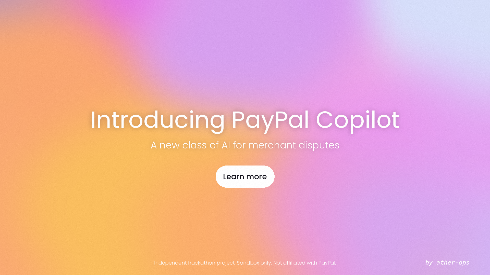
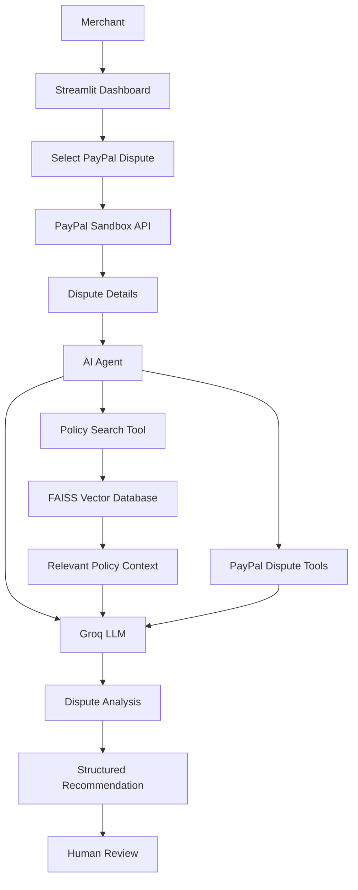

<p align="center">
  
</p>

<h1 align="center">PayPal Copilot</h1>

<p align="center">
  <b>AI-powered merchant dispute analysis and resolution assistant</b><br>
  Built for the PayPal AI Hackathon 2026
</p>

<p align="center">
  <a href="https://paypal-copilot-agenta.streamlit.app/"></a>
  <a href="https://www.python.org/"></a>
  <a href="https://groq.com/"></a>
  <a href="https://github.com/facebookresearch/faiss"></a>
  <a href="LICENSE"></a>
</p>

<p align="center">
  <a href="https://paypal-copilot-agenta.streamlit.app/"><b>Live app</b></a>
  &nbsp;|&nbsp; <a href="#how-it-works">How it works</a>
  &nbsp;|&nbsp; <a href="#getting-started">Getting started</a>
  &nbsp;|&nbsp; <a href="#running-tests">Tests</a>
</p>

<!-- Add the demo video link here, for example: | <a href="YOUR_VIDEO_LINK">Demo video</a> -->

---

**PayPal Copilot** helps merchants understand PayPal disputes, find the relevant policy guidance, check what evidence is available, and receive a structured recommendation. It combines PayPal Sandbox APIs, Retrieval-Augmented Generation (RAG) and LLM reasoning in one Streamlit interface.

> **Sandbox only.** This is an independent prototype. It never touches live merchant accounts and a person reviews every recommendation.

## Table of contents

- [Overview](#overview)
- [Key features](#key-features)
- [How it works](#how-it-works)
- [Agent tools](#agent-tools)
- [Knowledge base and RAG](#knowledge-base-and-rag)
- [Technology stack](#technology-stack)
- [Project structure](#project-structure)
- [Getting started](#getting-started)
- [Running tests](#running-tests)
- [Application screenshots](#application-screenshots)
- [Deployment](#deployment)
- [Security and limitations](#security-and-limitations)
- [Future improvements](#future-improvements)
- [Acknowledgements](#acknowledgements)
- [License](#license)
- [Disclaimer](#disclaimer)

## Overview

Handling a payment dispute is slow. A merchant has to understand why the buyer opened it, review the transaction, find the rules that apply, and work out what evidence is needed, usually before a deadline.

PayPal Copilot brings those steps into one place. It retrieves dispute information from the PayPal Sandbox, searches a locally indexed policy knowledge base, and uses an LLM agent to produce a recommendation the merchant can review.

## Key features

- **PayPal Sandbox integration:** retrieve open disputes and the details of any single dispute.
- **AI agent:** Groq-powered reasoning with function calling to choose and run the available tools.
- **Policy RAG:** semantic search over a FAISS index built from PayPal dispute knowledge-base content.
- **Evidence analysis:** helps evaluate the available dispute information and spot evidence gaps.
- **Structured recommendations:** every analysis ends with one of five outcomes:
  - `FIGHT`
  - `REFUND`
  - `OFFER`
  - `GATHER_MORE_EVIDENCE`
  - `ESCALATE`
- **Dispute dashboard:** browse disputes and inspect them one at a time.
- **Human review:** recommendations are shown for the merchant to review. Nothing is executed automatically.

## How it works



### Agent workflow

1. The merchant opens the dashboard and loads the available disputes.
2. The merchant selects a dispute to inspect.
3. The app retrieves that dispute's details from the PayPal Sandbox.
4. The AI agent receives the merchant's analysis request.
5. The agent chooses the relevant tools through Groq function calling.
6. The policy search tool retrieves matching knowledge-base content by semantic similarity.
7. The agent combines the dispute information with the retrieved policy context.
8. The app presents the analysis and recommended next steps for human review.

## Agent tools

| Module | Purpose |
|---|---|
| `tools/paypal_auth.py` | Gets and reuses a PayPal Sandbox access token |
| `tools/paypal_disputes.py` | Lists disputes from the Sandbox |
| `tools/paypal_disputes_details.py` | Reads the details of one dispute |
| `tools/paypal_tools.py` | Tool wrappers the agent can call |
| `tools/policy_search.py` | Semantic search over the policy knowledge base |
| `tools/groq_client.py` | Client for the Groq LLM |

## Knowledge base and RAG

PayPal Copilot uses a custom RAG pipeline to retrieve dispute-policy guidance.

**What the knowledge base covers**

- Dispute lifecycle: stages, statuses, deadlines and response options.
- Dispute reasons (item not received, not as described, unauthorized and others) and the evidence each one needs.
- Evidence types and what makes proof of delivery strong.
- Seller Protection rules, following the **United States** policy.
- Merchant actions: message, offer, accept, escalate and appeal.

The content is original, paraphrased summaries of public PayPal documentation. It is **not official PayPal text**, and rules differ by country.

**Retrieval pipeline**

1. The knowledge-base PDF content is processed and split into smaller text chunks.
2. Sentence Transformers (`all-MiniLM-L6-v2`) creates an embedding for each chunk.
3. The embeddings are normalized and stored in a FAISS index.
4. A merchant's question is converted into an embedding the same way.
5. FAISS similarity search returns the closest chunks.
6. The retrieved context is passed to the AI agent.

**Vector store**

```text
rag/
├── retriever.py
├── PayPal_RAG.ipynb
└── vector_store/
    ├── index.faiss
    ├── chunks.json
    └── config.json
```

The vector store is committed to the repository, so the deployed app can search policy content without rebuilding the index at startup.

## Technology stack

| Component | Technology |
|---|---|
| Frontend | Streamlit |
| Language | Python |
| LLM provider | Groq |
| Agent tool calling | Groq function calling |
| Agent tools | Smolagents |
| RAG framework | Custom RAG pipeline |
| Vector database | FAISS |
| Embedding model | Sentence Transformers (`all-MiniLM-L6-v2`) |
| API integration | PayPal REST API (Sandbox) |
| Data processing | NumPy, Pandas |
| API requests | Requests |
| Environment management | python-dotenv |
| Testing | Pytest |

## Project structure

```text
paypal-copilot/
│
├── .streamlit/
│
├── agent/
│   ├── agent.py
│   └── prompts.py
│
├── app/
│   └── app.py
│
├── assets/
│   └── paypal_copilot_cover.png
│
├── data/
│
├── docs/
│   └── samples/
│
├── images/
│   ├── test_img_1.png
│   ├── test_img_2.png
│   ├── test_img_3.png
│   ├── test_img_4.png
│   └── test_img_5.png
│
├── rag/
│   ├── PayPal_RAG.ipynb
│   ├── retriever.py
│   └── vector_store/
│
├── tools/
│   ├── groq_client.py
│   ├── paypal_auth.py
│   ├── paypal_disputes.py
│   ├── paypal_disputes_details.py
│   ├── paypal_tools.py
│   └── policy_search.py
│
├── tests/
│   ├── test_auth.py
│   ├── test_disputes.py
│   ├── test_disputes_details.py
│   ├── test_policy_search.py
│   └── test_agent.py
│
├── config.py
├── requirements.txt
├── README.md
├── LICENSE
└── TODO.md
```

## Getting started

### 1. Clone the repository

```bash
git clone https://github.com/ather-ops/paypal-copilot.git
cd paypal-copilot
```

### 2. Create a virtual environment

```bash
python -m venv .venv
```

Activate it:

**Windows**

```bash
.venv\Scripts\activate
```

**Linux / macOS**

```bash
source .venv/bin/activate
```

### 3. Install dependencies

```bash
python -m pip install --upgrade pip
pip install -r requirements.txt
```

The first run downloads the embedding model, so it needs an internet connection and can take a moment.

### 4. Configure environment variables

Create a `.env` file in the project root:

```env
PAYPAL_CLIENT_ID=your_paypal_sandbox_client_id
PAYPAL_CLIENT_SECRET=your_paypal_sandbox_client_secret

PAYPAL_BASE_URL=https://api-m.sandbox.paypal.com

GROQ_API_KEY=your_groq_api_key
GROQ_MODEL=openai/gpt-oss-120b
```

> **Important:** use PayPal **Sandbox** credentials, never live ones. Do not commit your `.env` file or share your keys.

### 5. Run the application

```bash
streamlit run app/app.py
```

The app opens in your browser.

## Running tests

Run the full suite:

```bash
python -m pytest tests/ -v
```

Or run one module at a time:

```bash
python -m pytest tests/test_auth.py -v
python -m pytest tests/test_disputes.py -v
python -m pytest tests/test_disputes_details.py -v
python -m pytest tests/test_policy_search.py -v
python -m pytest tests/test_agent.py -v
```

The tests cover:

- PayPal Sandbox authentication.
- Dispute retrieval.
- Single-dispute detail retrieval.
- Semantic policy retrieval.
- End-to-end agent tool calling.

## Application screenshots

Screenshots from testing and development:

| | |
|---|---|
|  |  |
|  |  |
|  | |

## Deployment

The app is deployed on Streamlit Community Cloud.

**Live demo:** [Open PayPal Copilot](https://paypal-copilot-agenta.streamlit.app/)

Credentials are provided through Streamlit Secrets. Required secrets:

```toml
PAYPAL_CLIENT_ID = "your_sandbox_client_id"
PAYPAL_CLIENT_SECRET = "your_sandbox_client_secret"
PAYPAL_BASE_URL = "https://api-m.sandbox.paypal.com"
GROQ_API_KEY = "your_groq_api_key"
GROQ_MODEL = "openai/gpt-oss-120b"
```

## Security and limitations

PayPal Copilot is a prototype built around the PayPal Sandbox.

- It does not connect to live merchant accounts.
- AI recommendations are suggestions, not guaranteed outcomes.
- Policy retrieval depends on the knowledge-base content, which may not reflect the latest PayPal policy updates.
- The knowledge base holds summaries of public PayPal documentation, not official PayPal text, and follows the United States Seller Protection policy.
- The app does not automatically submit evidence, issue refunds or run dispute actions.
- A person must review every recommendation before any real-world action.

Do not treat the prototype's output as a substitute for reading the actual dispute and PayPal's current requirements.

## Future improvements

- More advanced evidence evaluation.
- Evidence document ingestion and analysis.
- Better dispute-specific policy retrieval.
- Clearer confidence levels and explanations for each recommendation.
- Merchant authentication and account isolation.
- Persistent dispute history and audit logs.
- Human-approved action workflows.
- Production-grade security and deployment.

## Acknowledgements

Built with [Streamlit](https://streamlit.io/), [Groq](https://groq.com/), [FAISS](https://github.com/facebookresearch/faiss), [Sentence Transformers](https://www.sbert.net/), [smolagents](https://github.com/huggingface/smolagents) and the [PayPal developer platform](https://developer.paypal.com/).

## License

Released under the MIT License. See [LICENSE](LICENSE) for details.

## Disclaimer

PayPal Copilot is an independent experimental project created for demonstration and development purposes. It is not affiliated with, endorsed by, or officially associated with PayPal, Inc. PayPal is a trademark of its respective owner.

<p align="center"><sub>by ather-ops</sub></p>
